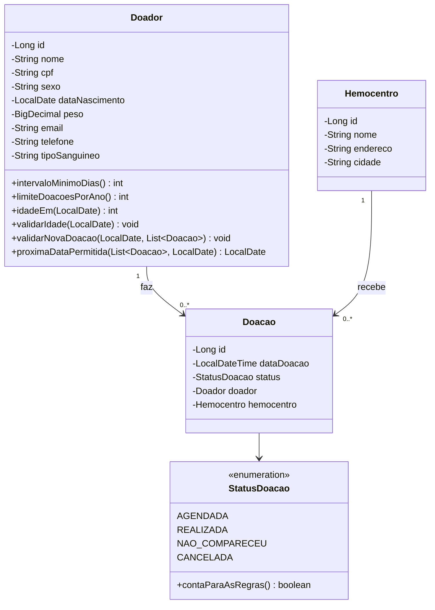
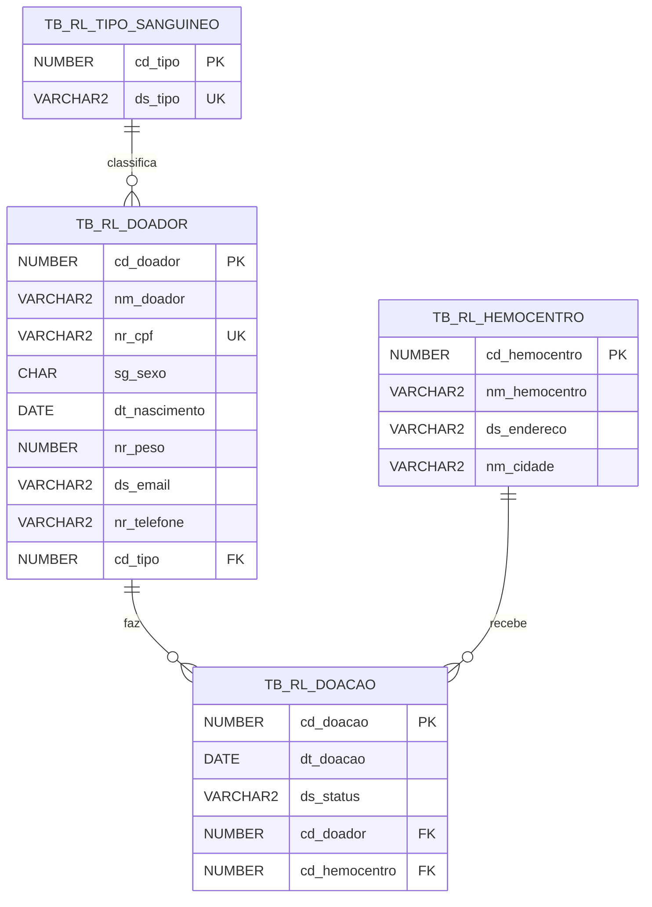

# RedLink API — Documentação Técnica

**Global Solution 2026/2 · CitizenTech · Domain Driven Design Using Java**

> Este arquivo é a base do PDF de documentação. Preencham os campos marcados com _PREENCHER_
> e exportem para PDF (os diagramas em Mermaid aparecem no GitHub e no VS Code; se preferirem,
> redesenhem no draw.io/Astah).

---

## 1. Capa e links

| Integrante | RM | Turma |
|------------|----|-------|
| Thiago Motitsuki Tan | RM570760 | 1TDSPI |
| Felipe Tenorio Diniz | RM568828 | 1TDSPI |
| João Pedro Rodrigues Siqueira | RM571316 | 1TDSPI |
| Arthur Netto Barbosa | RM569982 | 1TDSPI |
| Gustavo Tenorio de Souza | RM569032 | 1TDSPK |

- **API publicada (Render):** _PREENCHER_
- **Vídeo (YouTube, não listado):** _PREENCHER_

---

## 2. A solução

**O problema do cidadão.** Os hemocentros precisam de todos os tipos sanguíneos o tempo todo, mas
o estoque de cada tipo sobe e desce de forma diferente. Quando um tipo fica em falta, a resposta
costuma ser uma campanha genérica para a cidade inteira, que atrai gente com o tipo errado ou
que ainda não cumpriu o prazo entre doações — a pessoa vai ao hemocentro e volta sem doar.

**Quem usa.**

- **Doador** — quer saber quando pode doar de novo e agendar sem perder a viagem.
- **Hemocentro (atendente/gestora)** — recebe os agendamentos e marca cada doação como
  realizada, falta ou cancelada.
- **Paciente** — beneficiado indireto: encontra o sangue de que precisa.

**O que a API resolve.** Ela é o back-end da RedLink: guarda doadores, hemocentros e doações no
Oracle e garante que **nenhum agendamento desrespeite as regras oficiais de doação** (Secretaria
da Saúde do Estado de São Paulo): idade de 16 a 69 anos, peso mínimo de 50 kg, intervalo de 60
dias (homens) ou 90 dias (mulheres) e no máximo 4 (homens) ou 3 (mulheres) doações em 12 meses.
O front-end consome a API para cadastrar o doador, listar suas doações, agendar e responder
"posso doar?".

---

## 3. Diagrama de classes



Relacionamento 1:N principal: **um Doador tem várias Doações**. Há um segundo 1:N:
um Hemocentro recebe várias Doações.

---

## 4. Modelo do banco (DER)



- **Chave estrangeira do 1:N:** `tb_rl_doacao.cd_doador → tb_rl_doador.cd_doador`.
- **Sequences:** `sq_tb_rl_doador`, `sq_tb_rl_doacao`, `sq_tb_rl_hemocentro`.
- **CHECKs:** `sg_sexo IN ('M','F')`, `nr_peso >= 50`,
  `ds_status IN ('AGENDADA','REALIZADA','NAO_COMPARECEU','CANCELADA')`.
- Script completo: `sql/redlink.sql`.

---

## 5. Endpoints

| Método | Rota | Sucesso | Erros |
|--------|------|---------|-------|
| POST | `/doadores` | 201 + Location | 400 · 409 |
| GET | `/doadores` | 200 | — |
| GET | `/doadores/{id}` | 200 | 404 |
| PUT | `/doadores/{id}` | 200 | 400 · 404 · 409 |
| DELETE | `/doadores/{id}` | 204 | 404 · 409 |
| GET | `/doadores/{id}/doacoes` | 200 | 404 |
| POST | `/doadores/{id}/doacoes` | 201 + Location | 400 · 404 · 409 |
| GET | `/doadores/{id}/proxima-doacao` | 200 | 404 |
| GET | `/doacoes` | 200 | — |
| GET | `/doacoes/{id}` | 200 | 404 |
| PUT | `/doacoes/{id}` | 200 | 400 · 404 · 409 |
| DELETE | `/doacoes/{id}` | 204 | 404 |
| POST | `/hemocentros` | 201 + Location | 400 |
| GET | `/hemocentros` | 200 | — |
| GET | `/hemocentros/{id}` | 200 | 404 |
| PUT | `/hemocentros/{id}` | 200 | 400 · 404 |
| DELETE | `/hemocentros/{id}` | 204 | 404 · 409 |

Qualquer rota: **405** para método não suportado e **500** (mensagem genérica) para erro inesperado.

### 5.1 Doadores

**POST /doadores** — entrada:

```json
{
  "nome": "João Silva",
  "cpf": "12345678901",
  "sexo": "M",
  "dataNascimento": "1998-05-10",
  "peso": 72.5,
  "email": "joao@email.com",
  "telefone": "11999990000",
  "tipoSanguineo": "O-"
}
```

Saída — **201 Created**, cabeçalho `Location: /doadores/1`:

```json
{
  "id": 1,
  "nome": "João Silva",
  "sexo": "M",
  "dataNascimento": "1998-05-10",
  "peso": 72.5,
  "email": "joao@email.com",
  "telefone": "11999990000",
  "tipoSanguineo": "O-"
}
```

O CPF é recebido, mas **não é devolvido** em nenhuma resposta (dado pessoal — LGPD).

**GET /doadores/1/proxima-doacao** — saída (200):

```json
{
  "doadorId": 1,
  "podeDoar": false,
  "proximaDataPermitida": "2027-01-24",
  "intervaloMinimoDias": 60,
  "mensagem": "João Silva, você poderá doar novamente a partir de 24/01/2027."
}
```

### 5.2 Doações

**POST /doadores/1/doacoes** — entrada:

```json
{ "dataDoacao": "2026-11-25T10:00:00", "hemocentroId": 1 }
```

Saída — **201 Created**, cabeçalho `Location: /doacoes/1`:

```json
{
  "id": 1,
  "dataDoacao": "2026-11-25T10:00:00",
  "status": "AGENDADA",
  "doadorId": 1,
  "doadorNome": "João Silva",
  "hemocentroId": 1,
  "hemocentroNome": "Hemocentro Central"
}
```

**PUT /doacoes/1** — entrada (o hemocentro marca a doação como realizada):

```json
{ "dataDoacao": "2026-11-25T10:00:00", "hemocentroId": 1, "status": "REALIZADA" }
```

### 5.3 Hemocentros

**POST /hemocentros** — entrada:

```json
{ "nome": "Hemocentro Central", "endereco": "Av. Dr. Enéas Carvalho de Aguiar, 155", "cidade": "São Paulo" }
```

Saída (201): os mesmos campos, mais o `id`.

### 5.4 Erros (formato único)

**400** — validação:

```json
{
  "status": 400,
  "erro": "Dados inválidos",
  "mensagem": "Um ou mais campos estão inválidos. Veja a lista em \"campos\".",
  "timestamp": "2026-11-11T14:32:00",
  "campos": [
    { "campo": "peso", "mensagem": "O peso mínimo para doar sangue é 50 kg." },
    { "campo": "cpf", "mensagem": "O CPF deve ter exatamente 11 dígitos, sem pontos nem traço." }
  ]
}
```

**404** — id inexistente:

```json
{
  "status": 404,
  "erro": "Recurso não encontrado",
  "mensagem": "Doador com id 999 não foi encontrado(a).",
  "timestamp": "2026-11-11T14:32:00"
}
```

**409** — regra de negócio:

```json
{
  "status": 409,
  "erro": "Intervalo mínimo não cumprido",
  "mensagem": "A última doação foi em 25/11/2026. Homens devem aguardar 60 dias. Próxima data permitida: 24/01/2027.",
  "timestamp": "2026-11-11T14:32:00"
}
```

---

## 6. Estrutura do projeto

| Pacote | Responsabilidade | Classes |
|--------|------------------|---------|
| `model` | Entidades do domínio e as regras oficiais de doação | `Doador`, `Doacao`, `Hemocentro`, `StatusDoacao` |
| `dao` | Acesso ao Oracle com JDBC: `DataSource` no construtor e `PreparedStatement` | `DoadorDao`, `DoacaoDao`, `HemocentroDao` |
| `dto` | O que a API recebe (com Bean Validation) e devolve | `DoadorRequestDTO`, `DoadorResponseDTO`, `DoacaoRequestDTO`, `DoacaoUpdateDTO`, `DoacaoResponseDTO`, `HemocentroRequestDTO`, `HemocentroResponseDTO`, `ProximaDoacaoDTO`, `ErroDTO` |
| `controller` | Rotas REST, `@Valid` e status HTTP | `DoadorController`, `DoacaoController`, `HemocentroController` |
| `exception` | Erros do domínio | `RegraNegocioException` (base), `IntervaloMinimoException`, `LimiteAnualException`, `IdadeNaoPermitidaException`, `CpfJaCadastradoException`, `DoadorComDoacoesException`, `HemocentroComDoacoesException`, `RecursoNaoEncontradoException`, `ErroBancoException` |
| `handler` | `@RestControllerAdvice` que devolve todo erro no JSON padronizado | `GlobalExceptionHandler` |
| `config` | CORS e ModelMapper | `CorsConfig`, `ModelMapperConfig` |

**Caminho de uma requisição** (`POST /doadores/1/doacoes`):

1. O `DoadorController` recebe o JSON como `DoacaoRequestDTO`; o `@Valid` dispara o Bean Validation
   (se falhar, o handler devolve 400).
2. O controller busca o doador e o hemocentro nos DAOs (se não existirem, 404).
3. O controller pede ao **model** `Doador` que valide a nova doação contra o histórico
   (`validarNovaDoacao`) — se alguma regra for violada, a exceção vira 409 no handler.
4. O ModelMapper converte o DTO em `Doacao`; o `DoacaoDao` pega o próximo código na sequence e
   faz o `INSERT` com `PreparedStatement`.
5. O ModelMapper converte a `Doacao` em `DoacaoResponseDTO` e o controller devolve 201 com `Location`.

---

## 7. Regras de negócio e validações

### 7.1 Regras de negócio (exceções próprias → 409)

| Regra | Exceção |
|-------|---------|
| Não agendar doação a menos de 60 dias (homem) ou 90 dias (mulher) de outra doação agendada/realizada | `IntervaloMinimoException` |
| Não passar de 4 doações (homem) ou 3 (mulher) em 12 meses | `LimiteAnualException` |
| Doador precisa ter de 16 a 69 anos (no cadastro e na data da doação) | `IdadeNaoPermitidaException` |
| CPF não pode se repetir | `CpfJaCadastradoException` |
| Não remover doador que já tem doações | `DoadorComDoacoesException` |
| Não remover hemocentro que já recebeu doações | `HemocentroComDoacoesException` |
| Doador, doação ou hemocentro inexistente (→ 404) | `RecursoNaoEncontradoException` |

Doações com status `CANCELADA` ou `NAO_COMPARECEU` não contam para o intervalo nem para o limite.
As regras vêm da Secretaria da Saúde do Estado de São Paulo ("Requisitos básicos para doação de
sangue"). A API não substitui a triagem clínica; ela evita que a pessoa vá ao hemocentro antes do prazo.

### 7.2 Validações dos DTOs de entrada

**DoadorRequestDTO**

| Campo | Validações |
|-------|------------|
| `nome` | `@NotBlank`, `@Size(max = 100)` |
| `cpf` | `@NotBlank`, `@Pattern` (exatamente 11 dígitos) |
| `sexo` | `@NotBlank`, `@Pattern` (`M` ou `F`) |
| `dataNascimento` | `@NotNull`, `@Past` |
| `peso` | `@NotNull`, `@DecimalMin("50.0")`, `@DecimalMax("300.0")` |
| `email` | `@NotBlank`, `@Email`, `@Size(max = 120)` |
| `telefone` | `@Pattern` (10 ou 11 dígitos) — opcional |
| `tipoSanguineo` | `@NotBlank`, `@Pattern` (A+, A-, B+, B-, AB+, AB-, O+, O-) |

**DoacaoRequestDTO** (agendar)

| Campo | Validações |
|-------|------------|
| `dataDoacao` | `@NotNull`, `@Future` |
| `hemocentroId` | `@NotNull`, `@Positive` |

**DoacaoUpdateDTO** (atualizar)

| Campo | Validações |
|-------|------------|
| `dataDoacao` | `@NotNull` |
| `hemocentroId` | `@NotNull`, `@Positive` |
| `status` | `@NotBlank`, `@Pattern` (AGENDADA, REALIZADA, NAO_COMPARECEU, CANCELADA) |

**HemocentroRequestDTO**

| Campo | Validações |
|-------|------------|
| `nome` | `@NotBlank`, `@Size(max = 100)` |
| `endereco` | `@NotBlank`, `@Size(max = 200)` |
| `cidade` | `@NotBlank`, `@Size(max = 80)` |

---

## 8. Deploy

- **Dockerfile multi-stage:** a primeira etapa (`maven:3.9-eclipse-temurin-21`) compila o projeto;
  a segunda (`eclipse-temurin:21-jre`) roda só o `redlink-api.jar`.
- **Render:** *New > Web Service*, conectado ao repositório do GitHub, com *Language: Docker*.
  O Render constrói a imagem pelo Dockerfile e publica a API.
- **Variáveis de ambiente configuradas no Render** (somente os nomes; os valores não ficam no
  código nem nesta documentação):

| Variável | Para que serve |
|----------|----------------|
| `DB_URL` | URL JDBC do Oracle da FIAP |
| `DB_USER` | usuário do banco |
| `DB_PASSWORD` | senha do banco |
| `CORS_ORIGINS` | (opcional) endereço do front liberado no CORS |

- A porta é lida da variável `PORT`, que o próprio Render define.
- **CORS:** liberado em `CorsConfig` para os métodos GET, POST, PUT, DELETE e OPTIONS.
